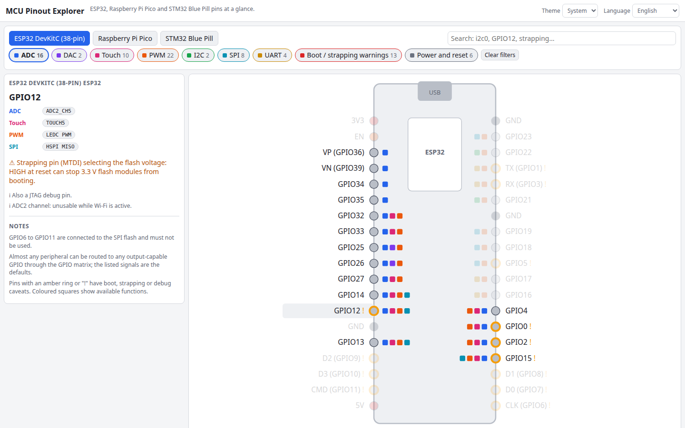

# MCU Pinout Explorer

An interactive pinout explorer for three popular boards: the ESP32 DevKitC, the Raspberry Pi Pico (RP2040) and the STM32 Blue Pill (F103C8). See the board drawn pin by pin, hover any pin for its functions, filter by ADC, PWM, I2C, SPI or UART, and spot the strapping and boot pin traps before they bite.

**Try it: [hermes98761234.github.io/mcu-pinout-explorer](https://hermes98761234.github.io/mcu-pinout-explorer/)**

[](https://github.com/hermes98761234/mcu-pinout-explorer/actions/workflows/deploy.yml)



## Features

- **Three boards**: ESP32 DevKitC (38-pin), Raspberry Pi Pico (40-pin, physical numbers shown) and STM32 Blue Pill.
- **Filter by function**: ADC, DAC, touch, PWM, I2C, SPI, UART, boot/strapping warnings, power and reset. Pick several to see pins matching any of them; the rest fade out.
- **Search** by pin name, signal (`i2c0 sda`, `TIM2_CH3`), physical number (`pin29`) or warning text (`strapping`).
- **Warnings that matter**: ESP32 strapping pins (GPIO0/2/5/12/15), flash pins, input-only pins, ADC2 vs Wi-Fi; Blue Pill JTAG/SWD pins, BOOT jumpers, 5 V tolerance; Pico notes.
- **Shareable**: the board, filters and search live in the URL hash.
- **English and Ukrainian**, light/dark/system theme. Nothing leaves your browser.

## How it works

The ESP32 and Blue Pill tables are hand-written from the datasheets. The Pico function table is generated from the RP2040 pin mux rules (SPI block = `(n/8) mod 2`, I2C block = `(n/2) mod 2`, PWM slice = `(n/2) mod 8`, the UART pattern 0,1,1,0 per group of four, ADC on GP26 to GP28) and checked by unit tests. Every pin carries a list of signals; a small classifier turns them into the filter tags.

## Quick start

You need [Node.js](https://nodejs.org/) 22.

```bash
git clone https://github.com/hermes98761234/mcu-pinout-explorer.git
cd mcu-pinout-explorer
npm install
npm run dev       # http://localhost:5173
npm test          # pin data and filter tests
npm run build     # static site in dist/
```

Pin data is for the common development boards; clones can differ, so double-check against your board's schematic before wiring anything important.

## License

MIT
